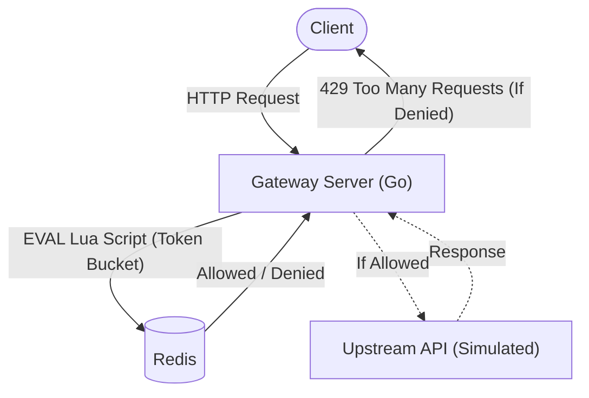

# Architecture — rate-limiter-service
> Last updated: 2026-08-29 | Maturity: Full Prototype
> _API gateway rate limiting service using Redis Lua scripting._

## System Diagram
The following Mermaid.js sequence diagram maps the core workflow and interactions:

## Component Table

| Component | File | Responsibility | Tech |
|---|---|---|---|
| API Server | `main.go` | Express server intercepting requests | Go |
| Rate Limiter | `middleware/limiter.go` | Middleware enforcing limits | Go |
| Lua Scripts | `middleware/redis.go` | Atomic token bucket logic | Lua/Redis |

## Port Assignments

| Service | Port | Notes |
|---|---|---|
| Gateway API | `8080` | Main entrypoint |
| Redis | `6379` | Backing store |

## Dependency Honesty Table

| Dependency | Status | Notes |
|---|---|---|
| Redis | **Real** | Required for atomic state tracking. |
| Upstream Service | **Simulated** | Returns a 200 OK immediately for demonstration purposes. |
