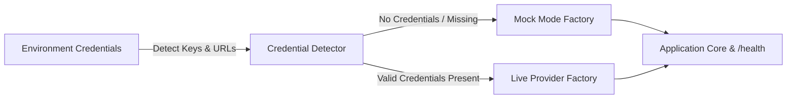

# Architecture — rate-limiter-service
> Last updated: 2026-08-29 | Maturity: Full Prototype
> _API gateway rate limiting service using Redis Lua scripting._

## System Diagram
The following Mermaid.js sequence diagram maps the core workflow and interactions:

## Component Table

| Component | File | Responsibility | Tech |
|---|---|---|---|
| API Server | `main.go` | Express server intercepting requests | Go |
| Rate Limiter | `middleware/limiter.go` | Middleware enforcing limits | Go |
| Lua Scripts | `middleware/redis.go` | Atomic token bucket logic | Lua/Redis |

## Port Assignments

| Service | Port | Notes |
|---|---|---|
| Gateway API | `8080` | Main entrypoint |
| Redis | `6379` | Backing store |

## Dependency Honesty Table

| Dependency | Status | Notes |
|---|---|---|
| Redis | **Real** | Required for atomic state tracking. |
| Upstream Service | **Simulated** | Returns a 200 OK immediately for demonstration purposes. |

## Progressive Credential Loading & Production Architecture (v0.2.0)

This service implements the **Progressive Credential Loading (PCL)** pattern, decoupling development speed from external infrastructure provisioning:

### Core Architecture Components
1. **Mode Detection Singleton:** Inspects environment configuration at boot time without hard crashes on missing secrets.
2. **Dual-Mode Factory Wrappers:**
   - **Storage / Cache:** In-process maps or SQLite `:memory:` transparently promote to managed Redis or PostgreSQL when connection strings are supplied.
   - **AI Providers:** Deterministic heuristic generators and local embeddings transparently promote to live OpenAI, Anthropic, or Gemini API clients.
3. **Hot-Reload & Dynamic TLS:** File watchers monitor mounted volume paths (Kubernetes ConfigMaps and Secrets) to update certificates and limit configs atomically without process restarts.
4. **Health & Observability:** The `/health` endpoint exposes real-time runtime mode metadata (`mock` vs `live`) across all backing adapters.
